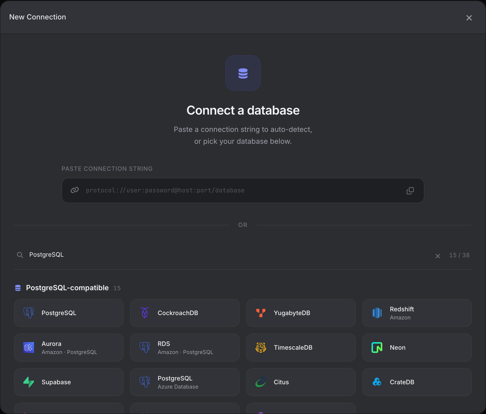
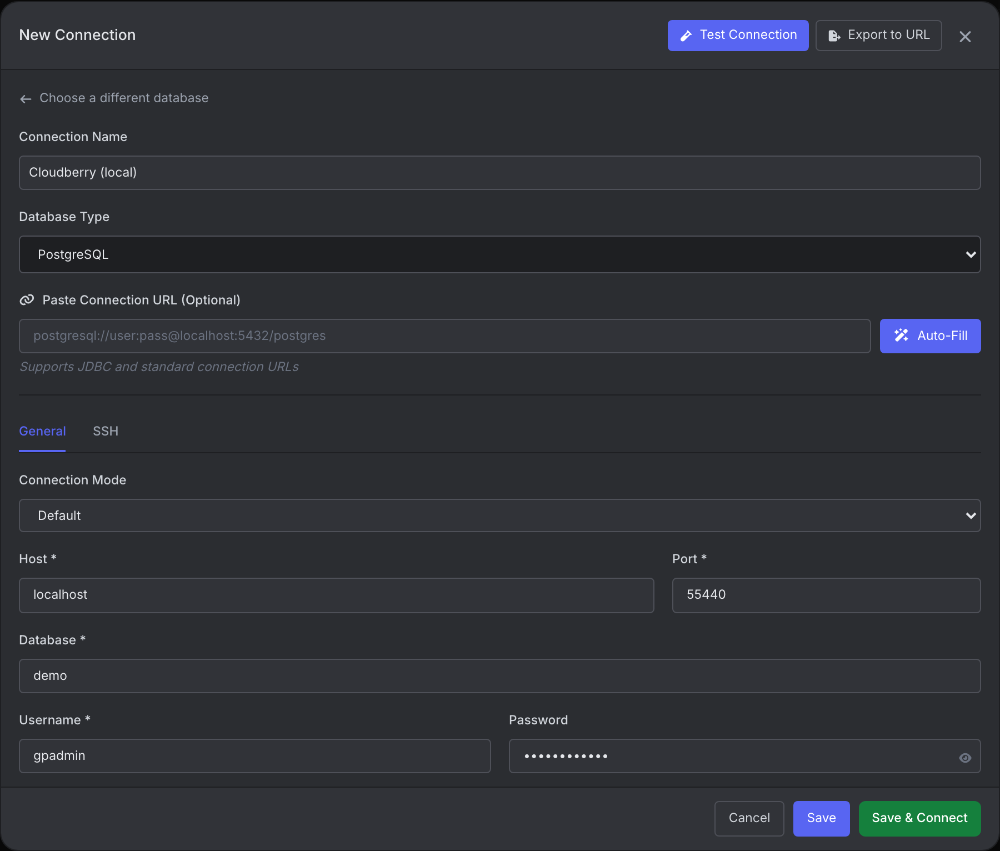
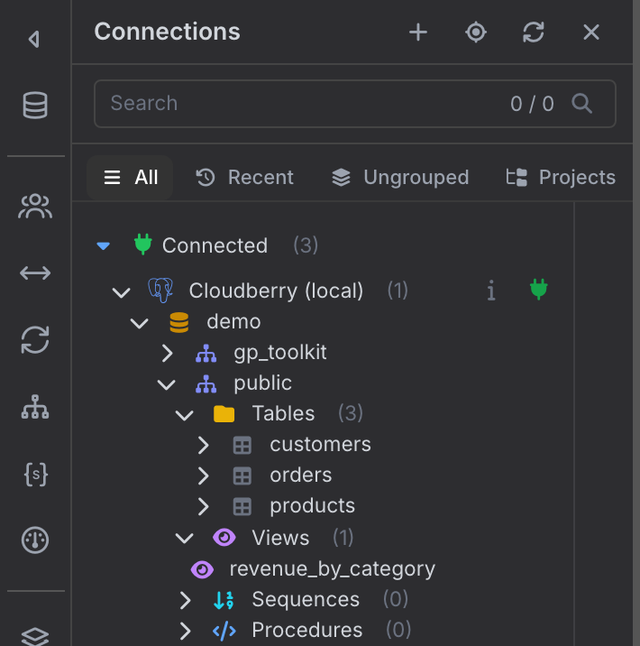
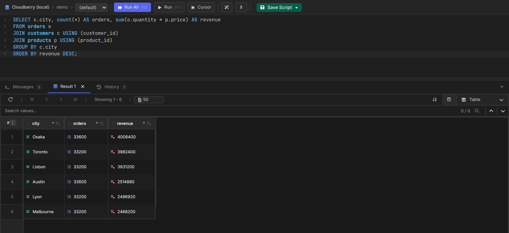

# VisuaLeaf

[VisuaLeaf](https://visualeaf.com/) is a desktop database client for Windows, macOS, and Linux, with a SQL editor, a results grid, a visual query builder, entity-relationship diagrams, and charts built from query results. It is available as a free Community Edition and in paid editions. It connects to Apache Cloudberry over the PostgreSQL wire protocol using its PostgreSQL connection type, the same way it connects to PostgreSQL itself.

## Prerequisites

- Apache Cloudberry is deployed with proper database access permissions set in `pg_hba.conf`. These steps were verified against Apache Cloudberry 2.1.0-incubating.
- [VisuaLeaf](https://visualeaf.com/download) is installed.
- The coordinator host, port (5432 by default), database name, and a role to connect as.

## Steps

1. Launch VisuaLeaf and click **New Connection**.

2. Search for "PostgreSQL" and select **PostgreSQL**. Cloudberry has no separate connection type of its own: it speaks the PostgreSQL wire protocol, so the PostgreSQL connection type is the correct choice.

3. Name the connection, then fill in the coordinator host and port, the database name, your username (for example, `gpadmin`), and password.

4. Click **Test Connection** to verify, then **Save & Connect**.

5. Expand the connection in the **Connections** sidebar. It lists the databases, schemas, tables, views, sequences, and procedures.

6. Right-click a database and select **New SQL Editor**. Click **Run All** (F5) to run the whole script, or select part of it and click **Run** (F9) to run only the selection. Results appear in the grid below the editor.

You can now browse schemas and run queries, including joins and aggregates, from the editor.
